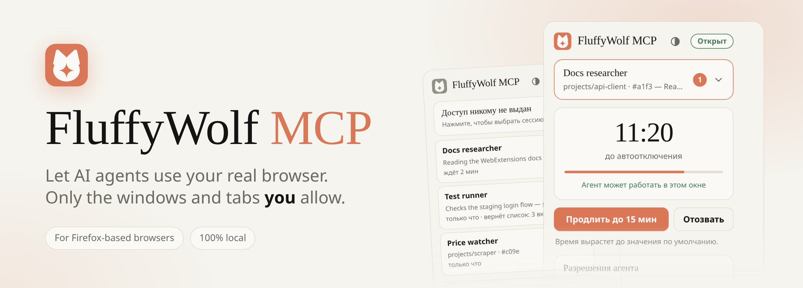
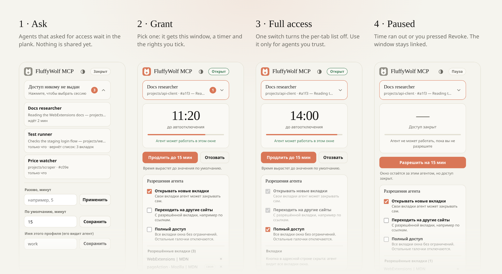
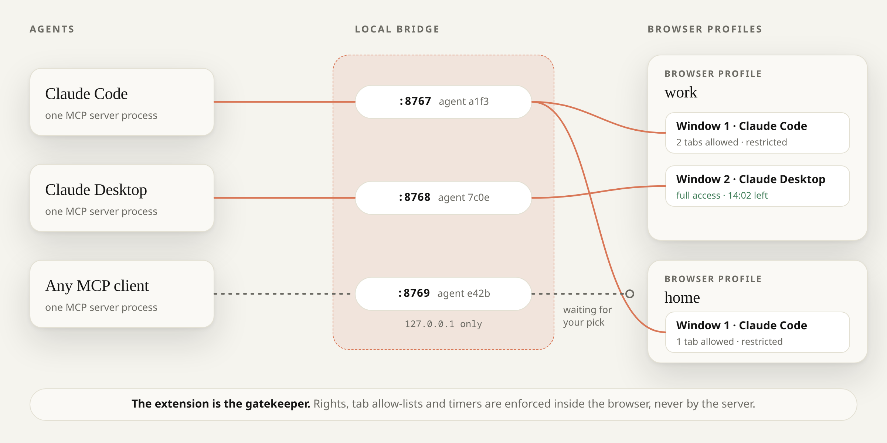
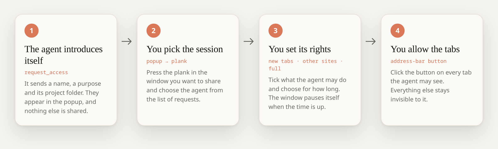
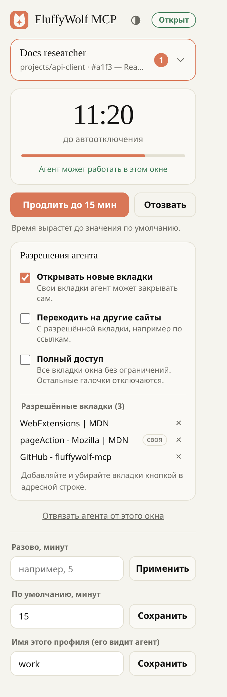
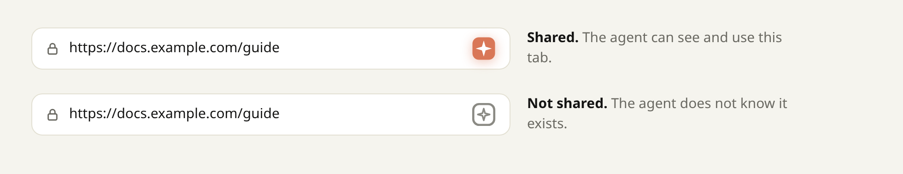

<div align="center">

<picture>
  <source media="(prefers-color-scheme: dark)" srcset="docs/images/hero-dark.png">
  
</picture>

<br>

[](LICENSE)
[](#supported-browsers)
[](https://modelcontextprotocol.io)
[](#quick-start)
[](#security-model)

**[Why](#why-fluffywolf-mcp)** · **[Quick start](#quick-start)** · **[How it works](#how-it-works)** · **[Using it](#using-it)** · **[Tools](#tools)** · **[Security](#security-model)** · **[Troubleshooting](#troubleshooting)** · **[Русский](README.ru.md)**

</div>

FluffyWolf MCP is an [MCP](https://modelcontextprotocol.io) server plus a WebExtension for Firefox-based browsers. It lets an AI agent such as Claude Code, Claude Desktop or Cursor read and drive the browser you already use, with your logins, cookies and open tabs. It also keeps the agent on a short leash.

An agent gets **nothing** by default. You give it **one window**, for **a limited time**, with **the rights you tick**, and it sees only **the tabs you click to share**. Everything else in your browser does not exist for it.

## Why FluffyWolf MCP

Giving an agent your logged-in browser is useful and risky: a single prompt injection on a web page can reach your mail, your bank and your work accounts. Most tools solve this by launching a separate empty browser, which throws away the reason to use your real one, or by trusting the agent completely. FluffyWolf MCP puts the access decision where it belongs, in your hands and in the browser.

<table>
<tr>
<td width="50%" valign="top">

### You grant windows, not the browser
Agents introduce themselves and wait. You press the plank in the window you want to share and pick one. That window, and only that window, belongs to that agent.

</td>
<td width="50%" valign="top">

### A tab only exists if you click for it
A restricted agent sees the tabs you shared with the address-bar button and the tabs it opened itself. `list_tabs` simply does not return the rest. One switch gives full access when you trust the agent.

</td>
</tr>
<tr>
<td valign="top">

### Time-boxed by default
Access runs out (15 minutes by default) and the window pauses itself. Extend it, revoke it or detach the agent at any moment. The clock is checked on every single command.

</td>
<td valign="top">

### Many agents, many windows, many profiles
Run several agents at once, each in its own window. Run several browser profiles at once, fully isolated: an agent has to list the profiles, then ask each one it needs. A profile it did not ask never learns the agent exists.

</td>
</tr>
<tr>
<td valign="top">

### Enforced by the browser, not by good manners
Rights, tab lists, site limits and timers live inside the extension. The MCP server is a thin bridge and cannot widen what you granted.

</td>
<td valign="top">

### The agent stays informed
If you switch tabs, close a page, open DevTools, navigate or change its rights, the agent is told on its next call. It always knows what it may do, and a refused call says which right is missing.

</td>
</tr>
</table>

Also: **local only** (the extension talks to `127.0.0.1` and nothing else, no cloud, no telemetry), **small and auditable** (about 1,900 lines of plain JavaScript, no runtime dependencies in the extension) and **tested** (a fake-browser scenario suite plus real server processes talking over real WebSockets).

### How it compares

Several projects connect Firefox to MCP. They make different trade-offs. This table is based on each project's public README in November 2026; projects change, so corrections are welcome.

| | **FluffyWolf MCP** | [firefox-devtools-mcp](https://github.com/mozilla/firefox-devtools-mcp) | [browser-control-mcp](https://github.com/eyalzh/browser-control-mcp) | [FoxMCP](https://github.com/ThinkerYzu/foxmcp) | [firefox-mcp](https://github.com/Antoniojesus122/firefox-mcp) | [Browser MCP Bridge](https://github.com/nullthrix/firefox-mcp-server) |
|---|:--:|:--:|:--:|:--:|:--:|:--:|
| Drives your real, logged-in browser | ✅ | optional | ✅ | ✅ | ✅ | ✅ |
| Clicks, typing, page scripts | ✅ | ✅ | ❌ read-only | ✅ | ✅ | ➖ |
| Access granted per window, to a chosen agent | ✅ | ➖ | ➖ | ➖ | ➖ | ➖ |
| Per-tab opt-in | ✅ | ➖ | screenshots only | ➖ | per domain | ✅ one tab |
| Time-limited access | ✅ | ➖ | ➖ | ➖ | ✅ | ➖ |
| Several agents isolated from each other | ✅ | ➖ | ➖ | shared, tabs not locked | ➖ | ➖ |
| Several browser profiles at once | ✅ isolated | ➖ | ➖ | ✅ | ➖ | ➖ |
| Agent is told when you change things | ✅ | ➖ | ➖ | ➖ | ➖ | ➖ |

✅ yes · ❌ no · ➖ not documented. "Optional" means it needs an extra launch mode and the project itself recommends a dedicated profile.

**Pick something else when** you need DevTools-grade debugging, console and network inspection or Firefox for Android ([firefox-devtools-mcp](https://github.com/mozilla/firefox-devtools-mcp), maintained by Mozilla), a large tool set with bookmarks, history and containers and an add-on listing on addons.mozilla.org ([FoxMCP](https://github.com/ThinkerYzu/foxmcp)), or a strictly read-only browser helper ([browser-control-mcp](https://github.com/eyalzh/browser-control-mcp)). On Chrome or Edge, [Playwright MCP's extension mode](https://playwright.dev/mcp/configuration/browser-extension) covers the same "use my real browser" need.

## See it

The extension's popup is the control panel. It follows your browser theme in light and dark.

<picture>
  <source media="(prefers-color-scheme: dark)" srcset="docs/images/states-dark.png">
  
</picture>

> [!NOTE]
> The popup interface is currently in **Russian** only. The captions above and everything in this README are in English. A localised popup is a welcome contribution.

## Supported browsers

The extension is a Manifest V2 WebExtension that uses the standard `pageAction`, `sessions` and `devtools` APIs, so it targets Firefox 109 and later and anything built on it.

| | Status |
|---|---|
| **LibreWolf** 156 (Flatpak, Linux) | Developed and tested here |
| Firefox ESR, Developer Edition, Nightly | Should work, not tested. They honour the unsigned-add-on switch described below |
| Firefox release and beta | Needs a signed build or a temporary install, see [Install it in the browser](#3-install-it-in-the-browser) |
| Zen, Floorp, Waterfox, Mullvad Browser and other forks | Expected to work, not tested |
| Windows, macOS | Not tested. Building the extension yourself needs the `zip` command, so on Windows use the release file or WSL / Git Bash |

If you try it elsewhere, please open an issue with the result so this table can grow.

## Quick start

You need **Node.js 18 or newer** and **npm**. Building the extension yourself also needs the **`zip`** command-line tool.

### 1. Get the code

```bash
git clone https://github.com/Cinnamon415/fluffywolf-mcp.git
cd fluffywolf-mcp
npm --prefix server install
```

### 2. Get the extension file

Pick one. Both give you a file you install in step 3.

| | Download the release | Build it yourself |
|---|---|---|
| How | Take `fluffywolf-mcp.xpi` from the [latest release](https://github.com/Cinnamon415/fluffywolf-mcp/releases/latest) | `npm run setup` creates `dist/fluffywolf-mcp.xpi` |
| Token | The **public default token**, the same for everyone, already known to the server | Your **own random token**, created in `.token` and picked up by the server automatically |
| Needs | Nothing more | The `zip` command |
| Good for | A quick try on a machine only you use | Everyday use, shared machines, anything you care about |

> [!WARNING]
> The released `.xpi` carries a token that is published in this repository. Anything on your computer can read it and could pose as your browser to the MCP server. Read [About the token](#about-the-token) and switch to your own build when you move beyond a quick try.

### 3. Install it in the browser

Do this **in every browser profile** you want agents to use, with the file from step 2.

<details open>
<summary><b>Option A. Permanent install of the unsigned build</b> (LibreWolf, Firefox ESR, Developer Edition, Nightly)</summary>

1. Open `about:config` and set `xpinstall.signatures.required` to `false`. The setting is per profile.
2. Open `about:addons`, click the gear icon, choose **Install Add-on From File…** and select the `.xpi` (the downloaded file or `dist/fluffywolf-mcp.xpi`).

If you prefer a click-through, run `npm run install-page`, open <http://127.0.0.1:8799/> in the browser and press the install button. Stop the helper with Ctrl+C afterwards.

</details>

<details>
<summary><b>Option B. Temporary install</b> (any Firefox-based browser, lasts until the browser restarts)</summary>

Open `about:debugging#/runtime/this-firefox`, click **Load Temporary Add-on…** and select the `.xpi` (or `extension/manifest.json` after `npm run build`).

</details>

<details>
<summary><b>Option C. Signed build</b> (Firefox release and beta, which refuse unsigned add-ons)</summary>

Mozilla signs add-ons for self-distribution for free: create an account on [addons.mozilla.org](https://addons.mozilla.org/developers/), generate API credentials and run `npx web-ext sign --channel=unlisted --source-dir extension --api-key=… --api-secret=…`. This is Mozilla's documented route and has not been run for this project yet. You will probably want to change `browser_specific_settings.gecko.id` in `extension/manifest.json` to an id you own first. If it was built with your own token, keep the signed file private.

</details>

After installing, open the extension's popup and type a recognisable name into the field at the bottom (for example `work` or `personal`). That name is what agents will see.

### 4. Register the MCP server in your client

Use the absolute path to `server/index.mjs`. The server finds its token by itself, see [About the token](#about-the-token).

**Claude Code**

```bash
claude mcp add --scope user fluffywolf -- node /absolute/path/to/fluffywolf-mcp/server/index.mjs
```

**Claude Desktop, Cursor and other clients with a JSON config** (`claude_desktop_config.json`, `.cursor/mcp.json`, …)

```json
{
  "mcpServers": {
    "fluffywolf": {
      "command": "node",
      "args": ["/absolute/path/to/fluffywolf-mcp/server/index.mjs"]
    }
  }
}
```

Restart the client or run `/mcp` in Claude Code to reconnect.

### 5. Try it

Ask your agent something like:

> List my browser profiles, then ask for access to the `work` profile as "Docs helper" because you want to read the Firefox WebExtensions docs.

The agent calls `list_profiles`, then `request_access`. A badge appears on the extension's toolbar button. Open the popup in the window you want to share, press the plank, pick **Docs helper**, and the agent is in. Then click the address-bar button on a tab to let it see that tab.

## How it works

<picture>
  <source media="(prefers-color-scheme: dark)" srcset="docs/images/architecture-dark.png">
  
</picture>

- **One MCP server process per agent.** Your MCP client starts it over stdio. It gets a random id and listens on its own local port, from `8767` to `8776`.
- **The extension connects out to those ports** (it re-scans every few seconds), one connection per agent. It accepts nothing from the network.
- **The extension decides.** Every command passes through it: is this agent bound to a window, is its time still running, is this tab allowed, is this site allowed. The server only relays.
- **Profiles are separate worlds.** Each profile has its own extension instance with its own records. The server talks to each one separately and never mixes their state.

### The access flow

<picture>
  <source media="(prefers-color-scheme: dark)" srcset="docs/images/flow-dark.png">
  
</picture>

## Using it

### Granting a window

Every browser window has its own popup. The plank at the top reads **"Доступ никому не выдан"** (no access given) until you pick someone. Press it to see the agents that asked for access, with their name, purpose, project folder and how long they have been waiting. Pick one and the plank shows its name.

- A window has **one** agent at a time. Picking another agent takes the window from the first one, which is told so.
- One agent can work in **several** windows.
- **Detach agent from this window** removes it completely: it disappears from the list of requests, and its next call returns a clear message that you removed it.

### Rights

<table>
<tr>
<td valign="top">

| Right | What it means |
|---|---|
| **Open new tabs** | The agent may open tabs. They are its own: it may close them, and they are allowed automatically. |
| **Go to other sites** | Off: a tab leaves the agent's list when it moves to a different site, and the agent is told. "Same site" includes subdomains. |
| **Full access** | Every tab of the window, any site, open and close freely. The other two boxes switch off, and so does the per-tab button. |

You also choose the time: a one-off number of minutes, or the default saved in the popup (15 to start, 1 to 1,440). **Extend** raises the remaining time to the default. **Revoke** pauses the agent immediately but keeps the window linked.

</td>
<td width="330" valign="top">

<picture>
  <source media="(prefers-color-scheme: dark)" srcset="docs/images/ui/bound-dark.png">
  
</picture>

</td>
</tr>
</table>

### Sharing tabs

When a restricted agent is bound to the window, the extension adds a button to the address bar of that window's tabs. Click it to share the current tab; click it again to take the tab back. The button disappears when the agent has full access or is gone, because there is nothing to decide any more.

<picture>
  <source media="(prefers-color-scheme: dark)" srcset="docs/images/address-bar-dark.png">
  
</picture>

The list of shared tabs is saved per agent, also stored with the tab through the `sessions` API, and kept for **a week** after the agent disconnects. Give the same agent's resume id back in `request_access` and it gets its list and rights back. Switching a window to a different agent starts that agent with its own list.

### What the agent is told

The agent always knows its rights: they are included in the access grant and in `status`, and a refused call says which right is missing. When *you* change something, the agent finds out on its **next MCP call**, as a short note at the end of the reply:

- you switched to another tab, opened or closed a page, or opened DevTools;
- you followed a link or navigated (changes after the `#` are ignored);
- you changed its rights or time, took the window away or detached it.

Plain scrolling and clicking are not reported. Everything waits for the agent's next call, because MCP clients such as Claude Desktop have no way to push a message into an agent between its own calls.

### Several agents, windows and profiles

An agent should first call `list_profiles`, then `request_access` naming the profiles it needs. If it has access in more than one profile, it passes `profile` to each tool; without it the call is refused with the list of choices. `list_tabs` without `profile` merges the tabs of all profiles and marks each one. Notes from a profile are prefixed with its name when more than one is running.

## Tools

| Tool | What it does |
|---|---|
| `list_profiles` | Running browser profiles, and whether the agent has asked each one. Call this first. |
| `request_access` | Introduce the agent (name, purpose, profiles, optional resume ids) and wait up to a minute for you to pick it. |
| `status` | Connection, state, shared windows, time left and rights, per profile. |
| `list_tabs` | The tabs the agent may use. Tabs it was not given are not listed. |
| `open_tab` | Open a URL in a shared window and wait for it to load. Needs *open new tabs*. |
| `close_tab` | Close a tab. Without full access, only the agent's own tabs. |
| `activate_tab` | Bring a tab to the front. |
| `navigate` | Go to a URL and wait for the load. Cross-site moves need *other sites*. |
| `history` | Back, forward or reload. |
| `snapshot` | Accessibility-style outline of the page with element refs. Preferred over screenshots. |
| `get_text` | Visible text of the page or of one element. |
| `click` | Click by ref, CSS selector or coordinates. |
| `type_text` | Type into an input, textarea or editable element. |
| `press_key` | Press a key or a shortcut such as `Control+a`. |
| `scroll` | Scroll by pixels, to top or bottom, or an element into view. |
| `evaluate` | Run JavaScript in the page and return the result as JSON. |
| `screenshot` | PNG of the visible area of a tab, including background tabs. |

## Configuration

| What | How |
|---|---|
| Default access time | Popup → "По умолчанию, минут" (default time in minutes). Saved in the browser. |
| Profile name | Popup → "Имя этого профиля" (profile name). Saved in the browser. |
| Token | Generated by the build into `.token`; nothing to configure. See [About the token](#about-the-token). |
| Base port | Set `FLUFFYWOLF_MCP_PORT` (default `8767`) **both** when you run `node build.mjs` and in the MCP server's environment. They must match. |
| Number of agents at once | Ten, on ports `base` to `base+9`. |

## Security model

**What is enforced, and where.** The extension checks every command against the agent's window, timer, tab list and site rights. The server never widens them. Tab ids an agent was not given are refused, and so are windows it was not bound to. Text an agent supplies (names, purposes) is stripped of control and bidirectional characters before it is shown to you or to other agents. Only the extension's own popup can change access; web pages and content scripts cannot.

**What keeps strangers out of the bridge.** The server listens on `127.0.0.1` only and accepts connections only from a `moz-extension://` origin that presents the shared secret. A web page cannot open that connection.

### About the token

**What it is.** A long random string that both sides must know. The extension sends it when it connects, and the server accepts only connections that present it. It stops *other things on your computer*, such as other users, sandboxed apps or other extensions, from posing as your browser to the MCP server. Web pages cannot connect at all: the server also checks the `moz-extension://` origin.

**Which token you are using.** The `.xpi` attached to a release is built with a **public default token**. It sits in [`default.token`](default.token) in this repository, and the server falls back to it when it finds nothing else. That makes a quick try work with zero setup. It also means everyone knows it. The server prints a warning in its log while it uses the default.

**Why you should change it.** With a known token, any process that can reach `127.0.0.1` on your machine can connect to your MCP server as if it were your browser. It could hand your agent fake page contents and read what the agent types, opens and asks for. It cannot widen the agent's rights or reach your real browser: those stay in the extension, and you still approve every agent in the popup. On a machine only you use, running nothing you do not trust, the risk is small. On a shared computer, or while you run unfamiliar software, use your own token.

**How to change it.** Build the extension yourself. The build script generates a random token for you, so there is nothing to invent or copy:

```bash
npm run setup      # creates a random .token and builds dist/fluffywolf-mcp.xpi with it
```

Install that `.xpi` in every profile in place of the released one. The server reads `.token` by itself, so there is nothing else to configure. To get a fresh token later, delete `.token`, run `npm run build` and reinstall the `.xpi` in every profile. The server looks in `.token` first and falls back to `default.token`. Keep your own `.xpi` and `.token` private: do not publish or share them. There is no per-install pairing yet.

### Limitations

- `evaluate` runs arbitrary JavaScript in a page the agent may use. It stays inside the three rights, but a script can do anything the page can, including `fetch` to other sites.
- "Same site" is an approximation of the registrable domain (the last two labels, plus a list of multi-tenant hosts such as `github.io`) and does not use the Public Suffix List.
- Clicks and key presses are synthetic DOM events. Pages that insist on trusted input, such as some file pickers and payment widgets, ignore them.
- Within about a second and a half after an agent command, changes in the browser are treated as the agent's own and not reported as yours.
- An agent that can run shell commands on your machine can read your browser profile and `.token` directly. This tool limits what an agent can do through the browser; it cannot limit a process that already has your user's privileges.
- Letting an agent read web pages always carries prompt-injection risk. The per-tab model exists to shrink that blast radius, not to remove it. Keep sensitive tabs unshared.
- The extension requests access to all sites (`<all_urls>`) because its content script runs on whichever page you share. It sends nothing anywhere except to `127.0.0.1`.

To report a vulnerability, see [SECURITY.md](SECURITY.md).

## Troubleshooting

<details>
<summary><b>Firefox says the add-on "could not be installed because it appears to be corrupt" or is not verified</b></summary>

Your browser enforces add-on signatures, and the build is unsigned. Release and beta Firefox always do. Use a browser that honours `xpinstall.signatures.required=false` (LibreWolf, Firefox ESR, Developer Edition, Nightly), load the extension temporarily from `about:debugging`, or sign it as described in [Install it in the browser](#3-install-it-in-the-browser).

</details>

<details>
<summary><b><code>list_profiles</code> is empty, or the agent gets "No browser profile is connected"</b></summary>

Check, in this order:

1. The browser is running and the extension is enabled in `about:addons`. Extensions are off in private windows unless you allow them.
2. The extension and the server use the **same token**. The released `.xpi` matches the server's `default.token`. If a `.token` file exists next to the server (from your own build), the server uses that instead, so install the `.xpi` you built, or remove the file. If you deleted `.token` and built again, the token changed: reinstall the new `.xpi` in every profile.
3. `FLUFFYWOLF_MCP_PORT` is identical when building and when starting the server.
4. Give it a few seconds. The extension scans for servers every four seconds.

</details>

<details>
<summary><b>The agent asked for access but does not appear in the popup</b></summary>

The popup belongs to one window. Open it in the window you want to share. If you just detached the agent, it has to call `request_access` again, by design. An agent that asked a profile you did not name in `profiles` is invisible to that profile.

</details>

<details>
<summary><b>Everything worked, then calls fail with "access is paused"</b></summary>

The time you granted ran out, or you pressed Revoke. Press **Allow** in the popup, or let the agent call `request_access` again to wait for you.

</details>

<details>
<summary><b><code>snapshot</code>, <code>click</code> or <code>get_text</code> fail on one particular page</b></summary>

Firefox does not let extensions run scripts on some pages: `about:` pages, `addons.mozilla.org`, `view-source:`, the built-in PDF viewer and similar. This is a browser rule, not a setting.

</details>

<details>
<summary><b>"All bridge ports are busy" in the server log</b></summary>

Each running agent takes one of ten ports starting at the base port. Another program may be using them, or more than ten agents are running at once. Close idle MCP sessions, or change the base port with `FLUFFYWOLF_MCP_PORT` and rebuild.

</details>

<details>
<summary><b>The agent clicked a button but nothing happened</b></summary>

Clicks are synthetic events, and a few pages ignore them. Ask the agent to use `snapshot`, then try `type_text` with `submit`, `press_key` or `evaluate` on the element. If the page genuinely needs a real click, do that step yourself.

</details>

<details>
<summary><b>I updated the code and now things behave oddly</b></summary>

The server and extension are meant to be updated together. Pull, then reinstall the `.xpi` in **every** profile (a new release file, or your own build after `npm run build`) and reconnect your MCP clients (`/mcp` in Claude Code). Your `.token` is kept, so your own token does not change.

</details>

## Development

```bash
npm run setup      # install server dependencies and build
npm test           # fake-browser scenarios + real servers over real WebSockets
npm run lint       # web-ext lint (0 errors expected; 5 warnings are known, see below)
npm run build      # rebuild dist/fluffywolf-mcp.xpi
node build.mjs --release   # what the release workflow runs: build with the public default.token
```

`npm run lint` reports five warnings that are expected: the `evaluate` tool needs `eval`, which triggers the custom-CSP and `eval` warnings, and the manifest does not declare data-collection permissions because it collects nothing.

```
extension/
  manifest.json   MV2 manifest, page action, devtools page
  policy.js       pure helpers: site matching, text cleaning, notices, rights wording
  background.js   the commands an agent can run
  events.js       tab, window and DevTools events; the address-bar button
  gate.js         agents, bindings, records, timers, the WebSocket client, popup API
  content.js      snapshot, click, type, scroll, evaluate inside pages
  popup.*         the control panel
server/index.mjs  MCP server (stdio) and the local WebSocket bridge
test/             agents.test.mjs (fake browser), server.test.mjs (real servers)
install/          optional local page that offers the .xpi for one-click install
build.mjs         creates the secret, writes extension/config.js, packs the .xpi
```

Contributions are welcome. Please run `npm test` and `npm run lint` first, and describe the browser and OS you tried it on.

## License

[MIT](LICENSE)
