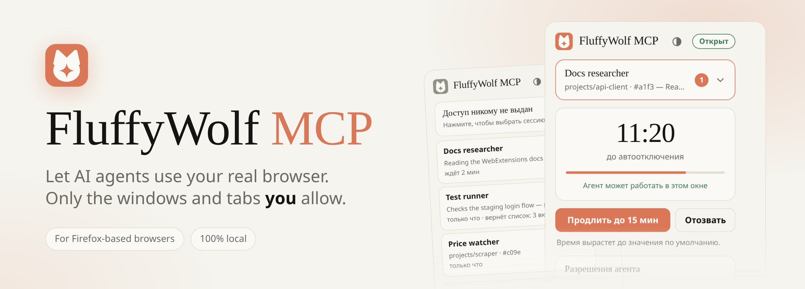
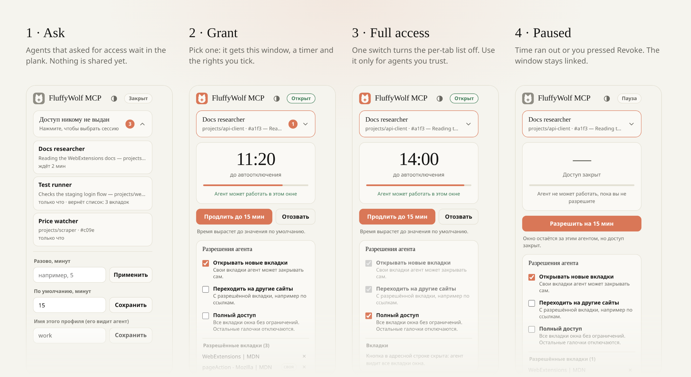
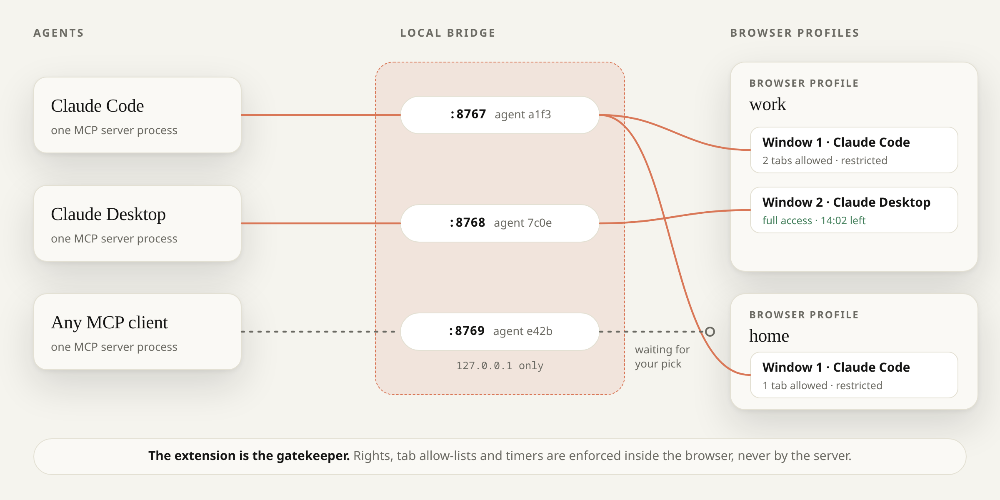
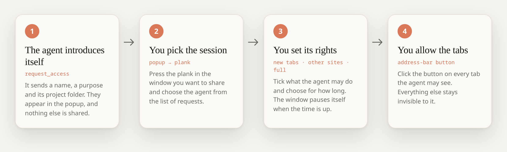
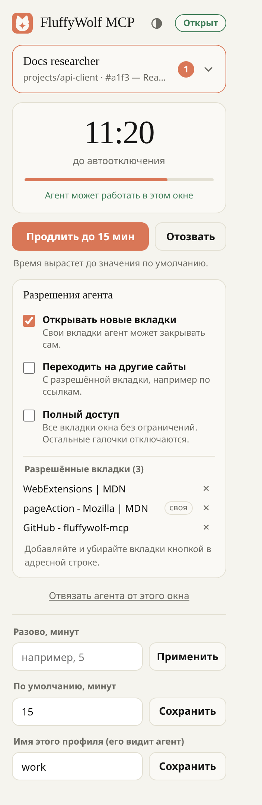
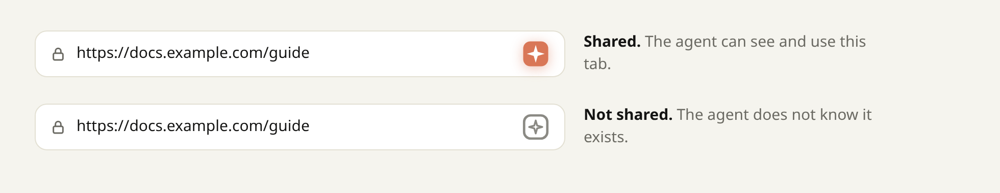

<div align="center">

**[🇬🇧 English](README.md)** &nbsp;·&nbsp; **🇷🇺 Русский**

<picture>
  <source media="(prefers-color-scheme: dark)" srcset="docs/images/hero-dark.png">
  
</picture>

<br>

[](LICENSE)
[](#поддерживаемые-браузеры)
[](https://modelcontextprotocol.io)
[](#быстрый-старт)
[](#модель-безопасности)

**[Зачем](#зачем-fluffywolf-mcp)** · **[Быстрый старт](#быстрый-старт)** · **[Как это работает](#как-это-работает)** · **[Использование](#использование)** · **[Инструменты](#инструменты)** · **[Безопасность](#модель-безопасности)** · **[Проблемы](#если-что-то-не-работает)** · **[🇬🇧 English](README.md)**

</div>

FluffyWolf MCP состоит из [MCP](https://modelcontextprotocol.io)-сервера и WebExtension для браузеров на базе Firefox. Он позволяет ИИ-агенту (Claude Code, Claude Desktop, Cursor и другим) читать и использовать тот браузер, которым вы уже пользуетесь: с вашими аккаунтами, куками и открытыми вкладками. При этом агент остаётся на коротком поводке.

По умолчанию агент не получает **ничего**. Вы даёте ему **одно окно**, **на ограниченное время**, с **теми правами, которые отметите**, и он видит только **те вкладки, которые вы разрешили кнопкой**. Всё остальное в вашем браузере для него не существует.

## Зачем FluffyWolf MCP

Отдать агенту браузер с вашими входами удобно и опасно: одна подсказка-инъекция на веб-странице может добраться до почты, банка и рабочих аккаунтов. Большинство инструментов решают это так: запускают отдельный пустой браузер (и теряют смысл работы в настоящем) или полностью доверяют агенту. FluffyWolf MCP оставляет решение о доступе там, где ему место: у вас и в браузере.

<table>
<tr>
<td width="50%" valign="top">

### Вы даёте окна, а не весь браузер
Агенты представляются и ждут. Вы нажимаете плашку в нужном окне и выбираете одного из них. Это окно, и только оно, принадлежит этому агенту.

</td>
<td width="50%" valign="top">

### Вкладка существует, только если вы её разрешили
Агент с ограничениями видит вкладки, которые вы дали кнопкой в адресной строке, и вкладки, которые открыл сам. `list_tabs` остальные просто не возвращает. Если агенту можно доверять, одна галочка включает полный доступ.

</td>
</tr>
<tr>
<td valign="top">

### Доступ по умолчанию ограничен временем
Доступ истекает (по умолчанию через 15 минут), и окно само встаёт на паузу. Время можно продлить, доступ отозвать, а агента отвязать в любой момент. Часы проверяются при каждой команде.

</td>
<td valign="top">

### Много агентов, окон и профилей
Можно запускать несколько агентов, каждого в своём окне, и несколько профилей браузера одновременно, полностью изолированных. Агент сначала узнаёт список профилей, потом просит доступ в нужных. Профиль, который он не просил, даже не узнает о его существовании.

</td>
</tr>
<tr>
<td valign="top">

### Правила держит браузер, а не вежливость агента
Права, списки вкладок, ограничения по сайтам и таймеры живут внутри расширения. MCP-сервер лишь передаёт команды и не может расширить то, что вы выдали.

</td>
<td valign="top">

### Агент в курсе происходящего
Если вы переключили вкладку, закрыли страницу, открыли DevTools, перешли по ссылке или изменили права агента, он узнаёт об этом при следующем вызове. Он всегда знает, что ему можно, а отказ говорит, какого права не хватает.

</td>
</tr>
</table>

Кроме того: **только локально** (расширение общается только с `127.0.0.1`, без облака и телеметрии), **компактно и проверяемо** (около 1 900 строк обычного JavaScript, у расширения нет зависимостей времени выполнения) и **с тестами** (сценарии с имитацией браузера и настоящие серверные процессы по настоящим WebSocket).

### Сравнение с другими

Несколько проектов соединяют Firefox с MCP, и у каждого свои компромиссы. Таблица составлена по публичным README этих проектов в ноябре 2026 года. Проекты меняются, поэтому поправки приветствуются.

| | **FluffyWolf MCP** | [firefox-devtools-mcp](https://github.com/mozilla/firefox-devtools-mcp) | [browser-control-mcp](https://github.com/eyalzh/browser-control-mcp) | [FoxMCP](https://github.com/ThinkerYzu/foxmcp) | [firefox-mcp](https://github.com/Antoniojesus122/firefox-mcp) | [Browser MCP Bridge](https://github.com/nullthrix/firefox-mcp-server) |
|---|:--:|:--:|:--:|:--:|:--:|:--:|
| Работает в вашем настоящем браузере с аккаунтами | ✅ | по желанию | ✅ | ✅ | ✅ | ✅ |
| Клики, ввод, скрипты на странице | ✅ | ✅ | ❌ только чтение | ✅ | ✅ | ➖ |
| Доступ к окну выбранному агенту | ✅ | ➖ | ➖ | ➖ | ➖ | ➖ |
| Разрешение отдельных вкладок | ✅ | ➖ | только скриншоты | ➖ | по доменам | ✅ одна вкладка |
| Доступ ограничен по времени | ✅ | ➖ | ➖ | ➖ | ✅ | ➖ |
| Несколько агентов, изолированных друг от друга | ✅ | ➖ | ➖ | общий доступ, вкладки не защищены | ➖ | ➖ |
| Несколько профилей браузера одновременно | ✅ изолированно | ➖ | ➖ | ✅ | ➖ | ➖ |
| Агент узнаёт об изменениях, которые вы сделали | ✅ | ➖ | ➖ | ➖ | ➖ | ➖ |

✅ да · ❌ нет · ➖ в документации не описано. «По желанию» значит, что нужен отдельный режим запуска, а сам проект рекомендует выделенный профиль.

**Выберите другой проект, если** вам нужна отладка уровня DevTools, консоль и сеть или Firefox для Android ([firefox-devtools-mcp](https://github.com/mozilla/firefox-devtools-mcp) от Mozilla), большой набор инструментов с закладками, историей и контейнерами и установка с addons.mozilla.org ([FoxMCP](https://github.com/ThinkerYzu/foxmcp)) или помощник строго только для чтения ([browser-control-mcp](https://github.com/eyalzh/browser-control-mcp)). Для Chrome и Edge то же самое делает [режим расширения в Playwright MCP](https://playwright.dev/mcp/configuration/browser-extension).

## Как это выглядит

Окно расширения служит панелью управления. Оно следует теме браузера, светлой или тёмной.

<picture>
  <source media="(prefers-color-scheme: dark)" srcset="docs/images/states-dark.png">
  
</picture>

Подписи на картинке английские, а сам интерфейс окна расширения русский, как в тексте ниже.

## Поддерживаемые браузеры

Расширение является WebExtension на Manifest V2 и использует стандартные API `pageAction`, `sessions` и `devtools`. Поэтому оно рассчитано на Firefox 109 и новее и на всё, что построено на нём.

| | Статус |
|---|---|
| **LibreWolf** 156 (Flatpak, Linux) | Разрабатывалось и проверялось здесь |
| Firefox ESR, Developer Edition, Nightly | Должно работать, не проверялось. Они поддерживают переключатель неподписанных дополнений, описанный ниже |
| Firefox release и beta | Не принимают неподписанные дополнения, поэтому работает только временная установка (до перезапуска браузера), см. [Установите его в браузер](#3-установите-его-в-браузер) |
| Zen, Floorp, Waterfox, Mullvad Browser и другие форки | Должно работать, не проверялось |
| Windows, macOS | Не проверялось. Для самостоятельной сборки нужна команда `zip`, поэтому в Windows берите файл из релиза или используйте WSL / Git Bash |

Если вы попробуете на другом браузере, откройте issue с результатом, и таблица пополнится.

## Быстрый старт

Нужны **Node.js 18 или новее** и **npm**. Для самостоятельной сборки расширения нужна ещё консольная утилита **`zip`**.

### 1. Получите код

```bash
git clone https://github.com/Cinnamon415/fluffywolf-mcp.git
cd fluffywolf-mcp
npm --prefix server install
```

### 2. Получите файл расширения

Выберите один способ. Оба дают файл, который вы поставите на шаге 3.

| | Скачать релиз | Собрать самому |
|---|---|---|
| Как | Возьмите `fluffywolf-mcp.xpi` из [последнего релиза](https://github.com/Cinnamon415/fluffywolf-mcp/releases/latest) | `npm run setup` создаёт `dist/fluffywolf-mcp.xpi` |
| Токен | **Публичный токен по умолчанию**, одинаковый у всех и уже известный серверу | **Ваш собственный случайный токен**: он создаётся в `.token`, и сервер подхватывает его сам |
| Нужно | Ничего больше | Команда `zip` |
| Подходит для | Быстрого знакомства на компьютере, которым пользуетесь только вы | Повседневной работы, общих компьютеров и всего, что вам дорого |

> [!WARNING]
> В `.xpi` из релиза зашит токен, опубликованный в этом репозитории. Любая программа на вашем компьютере может его прочитать и выдать себя серверу MCP за ваш браузер. Прочитайте [О токене](#о-токене) и переходите на собственную сборку, когда выйдете за рамки быстрого знакомства.

### 3. Установите его в браузер

Делайте это **в каждом профиле браузера**, где хотите использовать агентов, с файлом из шага 2.

<details open>
<summary><b>Вариант A. Постоянная установка неподписанной сборки</b> (LibreWolf, Firefox ESR, Developer Edition, Nightly)</summary>

1. Откройте `about:config` и поставьте `xpinstall.signatures.required` в `false`. Настройка действует на один профиль.
2. Откройте `about:addons`, нажмите на шестерёнку, выберите **Установить дополнение из файла…** и укажите `.xpi` (скачанный файл или `dist/fluffywolf-mcp.xpi`).

Если удобнее нажать кнопку, выполните `npm run install-page`, откройте в браузере <http://127.0.0.1:8799/> и нажмите кнопку установки. Потом остановите помощник через Ctrl+C.

</details>

<details>
<summary><b>Вариант B. Временная установка</b> (любой браузер на базе Firefox, до перезапуска браузера)</summary>

Откройте `about:debugging#/runtime/this-firefox`, нажмите **Загрузить временное дополнение…** и выберите `.xpi` (или `extension/manifest.json` после `npm run build`).

</details>

После установки откройте окно расширения и впишите в поле внизу понятное имя профиля, например `work` или `personal`. Именно это имя увидят агенты.

### 4. Подключите MCP-сервер к клиенту

Укажите абсолютный путь к `server/index.mjs`. Сервер сам находит свой токен, см. [О токене](#о-токене).

**Claude Code**

```bash
claude mcp add --scope user fluffywolf -- node /absolute/path/to/fluffywolf-mcp/server/index.mjs
```

**Claude Desktop, Cursor и другие клиенты с JSON-настройкой** (`claude_desktop_config.json`, `.cursor/mcp.json` и т. п.)

```json
{
  "mcpServers": {
    "fluffywolf": {
      "command": "node",
      "args": ["/absolute/path/to/fluffywolf-mcp/server/index.mjs"]
    }
  }
}
```

Перезапустите клиент или выполните `/mcp` в Claude Code, чтобы переподключиться.

### 5. Проверьте

Попросите агента что-нибудь вроде:

> Покажи мои профили браузера, затем попроси доступ к профилю `work` под именем «Docs helper», потому что тебе нужно прочитать документацию по WebExtensions.

Агент вызовет `list_profiles`, затем `request_access`. На кнопке расширения в панели браузера появится значок. Откройте окно расширения в том окне, которым хотите поделиться, нажмите плашку, выберите **Docs helper**, и агент подключён. Затем нажмите кнопку в адресной строке на вкладке, чтобы агент её увидел.

## Как это работает

<picture>
  <source media="(prefers-color-scheme: dark)" srcset="docs/images/architecture-dark.png">
  
</picture>

- **Один процесс MCP-сервера на агента.** Его запускает ваш MCP-клиент через stdio. Он получает случайный идентификатор и слушает свой локальный порт из диапазона `8767`–`8776`.
- **Расширение само подключается к этим портам** (оно сканирует их каждые несколько секунд), по одному соединению на агента. Из сети оно ничего не принимает.
- **Решает расширение.** Каждая команда проходит через него: привязан ли агент к окну, не вышло ли время, разрешена ли вкладка, разрешён ли сайт. Сервер только передаёт.
- **Профили разделены полностью.** В каждом профиле свой экземпляр расширения со своими записями. Сервер общается с каждым отдельно и не смешивает их состояние.

### Порядок выдачи доступа

<picture>
  <source media="(prefers-color-scheme: dark)" srcset="docs/images/flow-dark.png">
  
</picture>

## Использование

### Выдача окна

У каждого окна браузера своё окно расширения. Плашка сверху пишет **«Доступ никому не выдан»**, пока вы никого не выбрали. Нажмите её, чтобы увидеть агентов, которые просят доступ: имя, цель, папку проекта и сколько они ждут. Выберите одного, и на плашке появится его имя.

- У окна **один** агент одновременно. Если выбрать другого, окно уходит от первого, и тот об этом узнаёт.
- Один агент может работать в **нескольких** окнах.
- **«Отвязать агента от этого окна»** убирает агента полностью: он пропадает из списка запросов, а его следующий вызов вернёт понятное сообщение о том, что вы его убрали.

### Права

<table>
<tr>
<td valign="top">

| Право | Что значит |
|---|---|
| **Открывать новые вкладки** | Агент может открывать вкладки. Они его собственные: он может их закрывать, и они разрешены автоматически. |
| **Переходить на другие сайты** | Выключено: вкладка пропадает из списка агента, когда уходит на другой сайт, и агент получает уведомление. «Тот же сайт» включает поддомены. |
| **Полный доступ** | Все вкладки окна, любые сайты, открывать и закрывать свободно. Две другие галочки отключаются, как и кнопка для вкладок. |

Время тоже выбираете вы: разово указанное число минут или значение по умолчанию из окна расширения (сначала 15, допустимо от 1 до 1 440). **Продлить** поднимает оставшееся время до значения по умолчанию. **Отозвать** сразу ставит агента на паузу, но окно остаётся за ним.

</td>
<td width="330" valign="top">

<picture>
  <source media="(prefers-color-scheme: dark)" srcset="docs/images/ui/bound-dark.png">
  
</picture>

</td>
</tr>
</table>

### Разрешение вкладок

Пока к окну привязан агент с ограничениями, расширение добавляет в адресную строку вкладок этого окна кнопку. Нажмите её, чтобы поделиться текущей вкладкой, и нажмите ещё раз, чтобы забрать её обратно. Если у агента полный доступ или его нет, кнопка пропадает: решать больше нечего.

<picture>
  <source media="(prefers-color-scheme: dark)" srcset="docs/images/address-bar-dark.png">
  
</picture>

Список разрешённых вкладок хранится отдельно для каждого агента, дополнительно записывается во вкладку через API `sessions` и живёт **неделю** после отключения агента. Если агент передаст свой идентификатор в `request_access` (параметр `resume`), он получит назад свой список и права. Если окно переключить на другого агента, у того будет свой список.

### О чём узнаёт агент

Агент всегда знает свои права: они входят в сообщение о выдаче доступа и в `status`, а отказ называет, какого права не хватает. Когда что-то меняете **вы**, агент узнаёт об этом при **следующем вызове MCP** из короткой заметки в конце ответа:

- вы переключились на другую вкладку, открыли или закрыли страницу, открыли DevTools;
- вы перешли по ссылке или на другой адрес (изменения после `#` игнорируются);
- вы изменили его права или время, забрали окно или отвязали агента.

Простая прокрутка и клики не сообщаются. Всё ждёт следующего вызова агента, потому что MCP-клиенты вроде Claude Desktop не умеют отправлять агенту сообщение между его собственными вызовами.

### Несколько агентов, окон и профилей

Агенту стоит сначала вызвать `list_profiles`, а потом `request_access` с указанием нужных профилей. Если доступ есть больше чем в одном профиле, он передаёт `profile` в каждый инструмент, иначе вызов отклоняется со списком вариантов. `list_tabs` без `profile` объединяет вкладки всех профилей и помечает каждую. Заметки профиля получают его имя в начале, когда запущено больше одного.

## Инструменты

| Инструмент | Что делает |
|---|---|
| `list_profiles` | Запущенные профили браузера и то, просил ли агент доступ в каждом. Вызывать первым. |
| `request_access` | Представить агента (имя, цель, профили, необязательные id для возобновления) и ждать до минуты, пока вы его выберете. |
| `status` | Подключение, состояние, окна, оставшееся время и права по каждому профилю. |
| `list_tabs` | Вкладки, которые агенту можно использовать. Неразрешённые не показываются. |
| `open_tab` | Открыть адрес в окне, которым поделились, и дождаться загрузки. Нужно право *открывать новые вкладки*. |
| `close_tab` | Закрыть вкладку. Без полного доступа только собственные вкладки агента. |
| `activate_tab` | Вывести вкладку вперёд. |
| `navigate` | Перейти на адрес и дождаться загрузки. Для перехода на другой сайт нужно право *переходить на другие сайты*. |
| `history` | Назад, вперёд или перезагрузка. |
| `snapshot` | Структура страницы в виде дерева доступности со ссылками на элементы. Лучше скриншотов. |
| `get_text` | Видимый текст страницы или одного элемента. |
| `click` | Клик по ссылке-ref, CSS-селектору или координатам. |
| `type_text` | Ввод в поле, текстовую область или редактируемый элемент. |
| `press_key` | Нажать клавишу или сочетание вроде `Control+a`. |
| `scroll` | Прокрутка на число пикселей, к началу или концу или к элементу. |
| `evaluate` | Выполнить JavaScript на странице и вернуть результат в JSON. |
| `screenshot` | PNG видимой области вкладки, в том числе фоновой. |

## Настройка

| Что | Как |
|---|---|
| Время доступа по умолчанию | Окно расширения → «По умолчанию, минут». Хранится в браузере. |
| Имя профиля | Окно расширения → «Имя этого профиля (его видит агент)». Хранится в браузере. |
| Токен | Создаётся сборкой в `.token`, настраивать ничего не нужно. См. [О токене](#о-токене). |
| Базовый порт | Переменная `FLUFFYWOLF_MCP_PORT` (по умолчанию `8767`) **и** при запуске `node build.mjs`, **и** в окружении MCP-сервера. Значения должны совпадать. |
| Агентов одновременно | Десять, на портах от базового до базового + 9. |

## Модель безопасности

**Что проверяется и где.** Расширение сверяет каждую команду с окном агента, его таймером, списком вкладок и правами на сайты. Сервер ничего из этого не расширяет. Идентификаторы вкладок, которые агенту не выданы, отклоняются, как и окна, к которым он не привязан. Текст от агента (имена, цели) очищается от управляющих и двунаправленных символов перед показом вам и другим агентам. Менять доступ может только собственное окно расширения, веб-страницы и скрипты на страницах не могут.

**Что не пускает посторонних к мосту.** Сервер слушает только `127.0.0.1` и принимает соединения только от источника `moz-extension://`, который предъявляет общий секрет. Веб-страница такое соединение открыть не может.

### О токене

**Что это.** Длинная случайная строка, которую должны знать обе стороны. Расширение присылает её при подключении, а сервер принимает только тех, кто её назвал. Она не даёт *другим программам на вашем компьютере*, например другим пользователям, программам в песочнице или другим расширениям, выдавать себя серверу за ваш браузер. Веб-страницы подключиться не могут вообще: сервер ещё проверяет источник `moz-extension://`.

**Какой токен вы используете.** В `.xpi` из релиза зашит **публичный токен по умолчанию**. Он лежит в [`default.token`](default.token) в этом репозитории, и сервер берёт его, если ничего другого не нашёл. Благодаря этому быстрое знакомство работает без настройки. Но этот токен известен всем. Пока сервер использует его, он пишет предупреждение в свой лог.

**Зачем его менять.** Зная токен, любая программа, которая достаёт до `127.0.0.1` на вашем компьютере, может подключиться к вашему MCP-серверу вместо браузера. Она сможет подсунуть агенту поддельное содержимое страниц и увидеть, что агент вводит, открывает и о чём просит. Расширить права агента или добраться до вашего настоящего браузера она не сможет: права остаются в расширении, а каждого агента вы по-прежнему подтверждаете в окне расширения. На компьютере, которым пользуетесь только вы и где нет сомнительных программ, риск невелик. На общем компьютере или при запуске незнакомого софта используйте свой токен.

**Как поменять.** Соберите расширение сами. Скрипт сборки сам создаёт случайный токен, поэтому ничего придумывать и копировать не нужно:

```bash
npm run setup      # создаёт случайный .token и собирает с ним dist/fluffywolf-mcp.xpi
```

Поставьте этот `.xpi` в каждый профиль вместо релизного. Сервер читает `.token` сам, так что больше ничего настраивать не нужно. Чтобы позже получить новый токен, удалите `.token`, выполните `npm run build` и поставьте `.xpi` заново в каждый профиль. Сервер сначала смотрит в `.token`, а потом берёт `default.token`. Свой `.xpi` и `.token` держите при себе: не публикуйте и не передавайте их. Сопряжения при установке пока нет.

### Ограничения

- `evaluate` выполняет произвольный JavaScript на странице, которой агенту можно пользоваться. Он остаётся в рамках трёх прав, но скрипт может всё, что может страница, включая `fetch` на другие сайты.
- «Тот же сайт» является приближением к регистрируемому домену (последние две метки плюс список мультитенантных хостингов вроде `github.io`) и не использует Public Suffix List.
- Клики и нажатия клавиш синтетические DOM-события. Страницы, требующие настоящий ввод (некоторые окна выбора файлов и платёжные виджеты), их игнорируют.
- В течение примерно полутора секунд после команды агента изменения в браузере считаются его собственными и не сообщаются как ваши.
- Агент, который может выполнять команды на вашем компьютере, может сам прочитать ваш профиль браузера и `.token`. Этот инструмент ограничивает возможности агента через браузер, но не процесс, у которого уже есть права вашего пользователя.
- Чтение веб-страниц агентом всегда несёт риск инъекции подсказок. Модель с разрешением вкладок уменьшает ущерб, но не устраняет риск. Не делитесь важными вкладками.
- Расширение запрашивает доступ ко всем сайтам (`<all_urls>`), потому что его скрипт работает на той странице, которой вы поделились. Оно ничего никуда не отправляет, кроме `127.0.0.1`.

О найденной уязвимости сообщайте по инструкции в [SECURITY.md](SECURITY.md).

## Если что-то не работает

<details>
<summary><b>Firefox пишет, что дополнение «не удалось установить, так как оно повреждено», или что оно не проверено</b></summary>

Ваш браузер требует подписи дополнений, а сборка не подписана. Release и beta Firefox требуют всегда. Используйте браузер, который понимает `xpinstall.signatures.required=false` (LibreWolf, Firefox ESR, Developer Edition, Nightly), или загрузите расширение временно через `about:debugging` (см. [Установите его в браузер](#3-установите-его-в-браузер)).

</details>

<details>
<summary><b><code>list_profiles</code> пуст, или агент получает «No browser profile is connected»</b></summary>

Проверьте по порядку:

1. Браузер запущен, а расширение включено в `about:addons`. В приватных окнах расширения выключены, пока вы их не разрешите.
2. У расширения и сервера **один и тот же токен**. Релизный `.xpi` подходит к `default.token` сервера. Если рядом с сервером есть файл `.token` (от вашей сборки), сервер использует его, поэтому ставьте собранный вами `.xpi` или удалите файл. Если вы удалили `.token` и собрали заново, токен изменился: поставьте новый `.xpi` в каждый профиль.
3. `FLUFFYWOLF_MCP_PORT` одинаков при сборке и при запуске сервера.
4. Подождите несколько секунд. Расширение ищет серверы каждые четыре секунды.

</details>

<details>
<summary><b>Агент просил доступ, но его нет в окне расширения</b></summary>

Окно расширения принадлежит одному окну браузера. Откройте его в том окне, которым хотите поделиться. Если вы только что отвязали агента, ему нужно снова вызвать `request_access`, так задумано. Агент, который просил доступ у профиля, не названного в `profiles`, для него невидим.

</details>

<details>
<summary><b>Всё работало, а теперь вызовы падают с «access is paused»</b></summary>

Время, которое вы выдали, закончилось, или вы нажали «Отозвать». Нажмите **«Разрешить»** в окне расширения или пусть агент снова вызовет `request_access` и подождёт вас.

</details>

<details>
<summary><b><code>snapshot</code>, <code>click</code> или <code>get_text</code> не работают на одной конкретной странице</b></summary>

Firefox не разрешает расширениям запускать скрипты на некоторых страницах: `about:`, `addons.mozilla.org`, `view-source:`, встроенный просмотр PDF и подобные. Это правило браузера, не настройка.

</details>

<details>
<summary><b>«All bridge ports are busy» в логе сервера</b></summary>

Каждый запущенный агент занимает один из десяти портов, начиная с базового. Возможно, их использует другая программа или запущено больше десяти агентов одновременно. Закройте лишние MCP-сессии или поменяйте базовый порт через `FLUFFYWOLF_MCP_PORT` и пересоберите.

</details>

<details>
<summary><b>Агент нажал кнопку, но ничего не произошло</b></summary>

Клики синтетические, и некоторые страницы их игнорируют. Пусть агент сделает `snapshot`, а затем попробует `type_text` с `submit`, `press_key` или `evaluate` на элементе. Если странице действительно нужен настоящий клик, сделайте этот шаг сами.

</details>

<details>
<summary><b>Я обновил код, и всё ведёт себя странно</b></summary>

Сервер и расширение нужно обновлять вместе. Выполните pull, затем поставьте `.xpi` заново в **каждый** профиль (новый файл из релиза или свою сборку после `npm run build`) и переподключите MCP-клиенты (`/mcp` в Claude Code). Ваш `.token` сохраняется, поэтому ваш токен не меняется.

</details>

## Разработка

```bash
npm run setup      # поставить зависимости сервера и собрать
npm test           # сценарии с имитацией браузера и настоящие серверы по WebSocket
npm run lint       # web-ext lint (ожидается 0 ошибок; 5 предупреждений известны, см. ниже)
npm run build      # пересобрать dist/fluffywolf-mcp.xpi
node build.mjs --release   # так собирает релиз workflow: с публичным default.token
```

`npm run lint` выдаёт пять ожидаемых предупреждений: инструменту `evaluate` нужен `eval`, из-за него появляются предупреждения про собственный CSP и `eval`, а манифест не объявляет права на сбор данных, потому что ничего не собирает.

```
extension/
  manifest.json   манифест MV2, page action, страница devtools
  policy.js       чистые функции: сопоставление сайтов, очистка текста, заметки, формулировки прав
  background.js   команды, которые может выполнять агент
  events.js       события вкладок, окон и DevTools; кнопка в адресной строке
  gate.js         агенты, привязки, записи, таймеры, клиент WebSocket, API окна расширения
  content.js      snapshot, click, ввод, прокрутка, evaluate внутри страниц
  popup.*         панель управления
server/index.mjs  MCP-сервер (stdio) и локальный мост WebSocket
test/             agents.test.mjs (имитация браузера), server.test.mjs (настоящие серверы)
install/          необязательная локальная страница с .xpi для установки в один клик
build.mjs         создаёт секрет, пишет extension/config.js, упаковывает .xpi
```

Мы будем рады вашим вкладам. Перед отправкой запустите `npm test` и `npm run lint` и опишите, на каком браузере и системе вы пробовали.

## Лицензия

[MIT](LICENSE)
